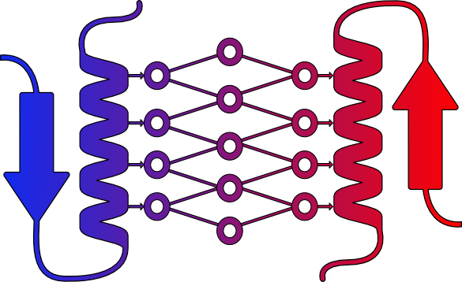

# THOR

THOR generates thermostable variants of a protein sequence while preserving its
family identity. It is a CycleGAN over protein sequences: a generator maps a
mesophilic sequence to a thermophilic counterpart, constrained by per-position
amino-acid likelihoods from ESM-1v and by a temperature regressor that scores
how thermophilic the result looks.



## The three models

| Model | What it is | Trained by |
|---|---|---|
| **THOR generator** | CycleGAN generator + discriminators over sequence space | `src/scripts/train_thor.sh` |
| **ET regressor** | CNN predicting environmental temperature from sequence; used as the GAN's temperature critic and to score variants | `src/scripts/train_et_regressor.sh` |
| **ESM-1v (fine-tuned)** | Masked-LM providing per-position substitution probabilities | `src/scripts/finetune_ESM.sh` |

## Quick start

Generating variants from a FASTA needs only a trained run directory — no
TFRecord preprocessing:

```sh
cd src/scripts
python generate_thor.py \
    --run_dir    <results/TIMESTAMPconfig_NN.yaml> \  # trained run: config.yaml + weights/
    --weights    weights/epoch_39 \                   # relative to --run_dir
    --fasta      <input.fasta> \
    --replicates 10 \
    --output_dir <out/>
```

This computes ESM likelihoods inline, runs the generator, and writes a FASTA of
variants plus per-variant metrics (generator and ESM negative log-likelihood,
predicted temperature). `src/scripts/generate_thor_colab.ipynb` wraps the same
script for a single pasted sequence.

Training the generator from scratch instead:

```sh
cd src/scripts
sbatch --array=0 train_thor.sh      # -> train_thor.py -c <config>.yaml
```

Full descriptions of every script and its arguments: **[`src/README.md`](src/README.md)**.

## Repository layout

```
config/           YAML configs: Cycle_gan/ (THOR), Classifier/ (ET regressor)
env/              Conda environment files and Singularity recipes
src/
  scripts/        Entry points - training, generation, prediction
    data_processing/    Feature computation and TFRecord pipeline
      dataset_construction/   How the training data was built from IMG
      archive/              Superseded scripts, with provenance notes
    archive/        Superseded scripts, with provenance notes
  utils/          Model definitions, layers, losses, data loaders
```

Each `archive/` directory has a README explaining what each retired script was
and what replaced it.

## Dependencies

Everything runs inside Singularity/Apptainer containers. The recipes are in
`env/singularity/`:

| Image | Recipe | Used by |
|---|---|---|
| `thermalgan-image1.sif` | `thermalgan-image1.recipie` | THOR training and generation (TensorFlow 2.13, CUDA) |
| `esm-finetune.sif` | `esm-finetune.recipe` | ESM-1v fine-tuning and feature computation (PyTorch 2.3.1, CUDA 12.1, HF Transformers) |

Build with:

```sh
singularity build thermalgan-image1.sif env/singularity/thermalgan-image1.recipie
```

Core requirements, if you prefer to assemble an environment by hand:
TensorFlow 2.13 (+ `tensorflow-addons`), PyTorch 2.3, `transformers`,
`biopython`, `pyyaml`, `pandas`, `numpy`, `simple_pid`. Conda specifications
for individual steps are in `env/`.

Hardware: THOR training was run on 4×A100 (80 GB). Generation from a FASTA fits
comfortably on a single A40 or T4.

## Running elsewhere

> **The SLURM wrappers (`*.sh`) carry absolute paths from the cluster THOR was
> developed on**, under `/mimer/NOBACKUP/groups/snic2022-6-127/...`, together
> with SLURM account names that will not exist for you. Before running any
> wrapper, edit the `SRC_DIR`, `DATA_DIR` and `IMAGE` variables near the top and
> replace `#SBATCH --account=...`.

The Python scripts themselves take ordinary command-line arguments and can be
run directly, which is usually the simpler route — see
[`src/README.md`](src/README.md) for each one's interface.

## Citation

<!-- TODO: add once the preprint is posted -->
